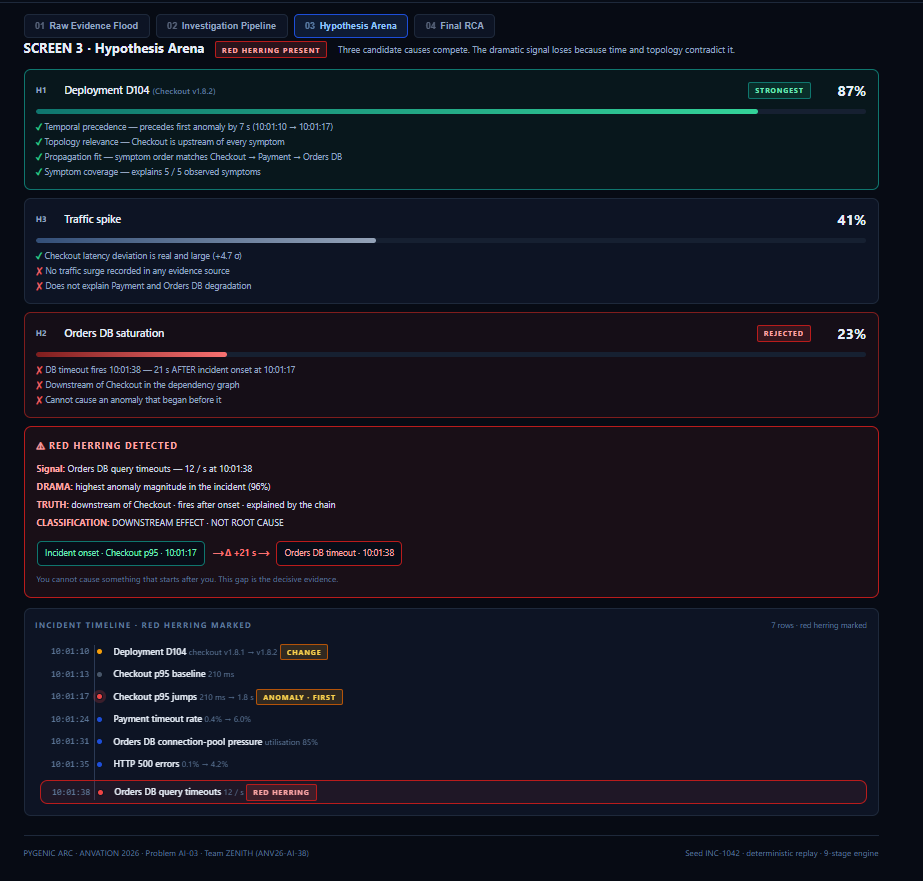
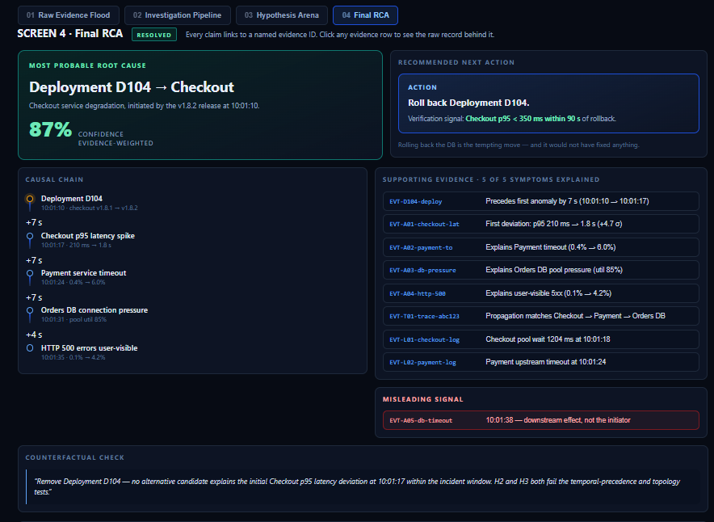
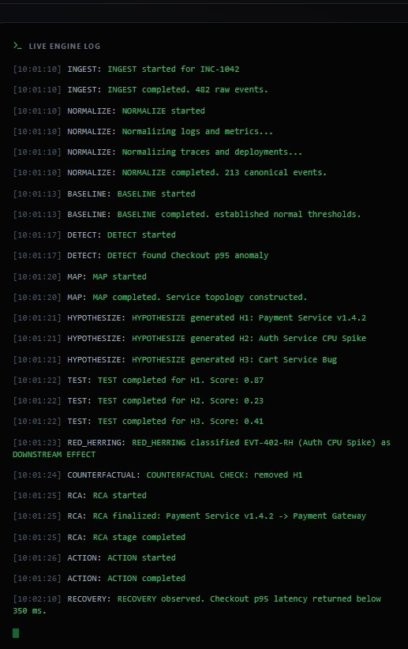

# 🔍 Incident Intelligence

### AI-Assisted Production Incident Investigation & Root-Cause Analysis Engine

[](https://pygenic-arc.vercel.app)
[](https://pygenic-arc.vercel.app/api/docs)

> Built for **Anvation 2026** Hackathon · Problem **AI-03** · Team **ZENITH** · 🥉 2nd Runner-Up

---

## 📋 Table of Contents

- [What is Incident Intelligence?](#-what-is-incident-intelligence)
- [The Problem](#-the-problem)
- [Our Solution](#-our-solution)
- [Key Features](#-key-features)
- [How It Works — Step by Step](#-how-it-works--step-by-step)
- [Technical Architecture](#-technical-architecture)
- [Demo](#-demo)
- [Live Deployment](#-live-deployment)
- [Tech Stack](#-tech-stack)
- [Project Structure](#-project-structure)
- [Getting Started](#-getting-started)
- [API Reference](#-api-reference)
- [Implementation Highlights](#-implementation-highlights)
- [Included Scenarios](#-included-scenarios)
- [Limitations & Future Scope](#-limitations--future-scope)

---

## 🧠 What is Incident Intelligence?

**Incident Intelligence** is a production incident investigation system that takes raw operational evidence — logs, metrics, distributed traces, and deployment change records — and reconstructs the incident timeline, scores root-cause hypotheses against multiple causal signals, rejects red herrings, and produces a defensible Root Cause Analysis (RCA) with confidence scoring and counterfactual validation.

Instead of requiring engineers to manually correlate dozens of dashboards and log streams under pressure, this system automates the structured reasoning process that experienced SREs follow during incident response.

---

## 🔥 The Problem

When a production incident strikes, on-call engineers face:

| Challenge | Reality |
|-----------|---------|
| **Evidence overload** | Hundreds of log lines, metric anomalies, and alerts fire simultaneously |
| **Red herrings** | The loudest signal is often not the root cause — a 94% Redis memory alert may be a weeks-old slow drift, not the incident trigger |
| **Time pressure** | Every minute of downtime = revenue loss, user impact, SLA breach |
| **Correlation is manual** | Engineers must mentally cross-reference logs → metrics → traces → deployment diffs |
| **Misleading symptoms** | Downstream effects (like scaling up the gateway) look like actions but have no effect because the problem is upstream |

> The hardest part of incident response isn't fixing the problem — it's **finding** it.

---

## 💡 Our Solution

Incident Intelligence implements a **10-stage automated investigation pipeline** that mirrors how expert SREs reason through incidents:

```
Evidence In → Ingest → Normalize → Baseline → Detect → Map Dependencies
           → Build Event Graph → Hypothesize → Test → Reject Red Herrings → Emit RCA
```

The system doesn't just find anomalies — it **ranks competing hypotheses**, **explains why each was accepted or rejected**, and **validates the conclusion** using counterfactual analysis ("if we remove this event, do the symptoms disappear?").

---

## ✨ Key Features

### 📊 Raw Evidence Explorer
- **Incident Timeline** — Color-coded events classified by role (CAUSE, SYMPTOM, RED_HERRING, MISLEADING, NOISE, FIX, RECOVERY)
- **Log Viewer** — Filterable by service and severity level with trace ID correlation
- **Metric Charts** — Interactive time-series visualizations (Recharts) for failure rates, latency, pool utilization, and more
- **Trace Waterfall** — Distributed trace spans showing request flow and where latency/errors occur
- **Changes Feed** — Deployment and config change timeline with diff details

### 🔬 Live Investigation Pipeline
- **10-stage animated pipeline** with real-time streaming logs via Server-Sent Events (SSE)
- Stages: INGEST → NORMALIZE → BASELINE → DETECT → MAP → EVENT_GRAPH → HYPOTHESIZE → TEST → REJECT → RCA
- Each stage card shows input/output counts and detailed descriptions
- **Live Engine Log** — terminal-style streaming output showing the investigation in real time
- Auto-detection: connects to FastAPI backend when available, falls back to local simulation

### 🗺️ Dependency Graph & Causal Chain
- **Interactive SVG topology graph** showing service relationships
- **Failure path highlighting** — causal chain nodes and edges glow red to visualize propagation
- **Causal chain visualization** — ordered sequence showing how the root cause cascaded through the system

### 🧪 Hypothesis Scoring & Diagnostics
- Each root-cause candidate is scored against **5 causal signals**:
  - Temporal Precedence — did this event precede the onset?
  - Topological Proximity — is it upstream of the failing services?
  - Anomaly Onset Ordering — does the propagation order match the dependency graph?
  - Blast Radius Coverage — does it explain the affected services?
  - Change Correlation — is there a matching deployment/config change?
- **Animated score reveal** — signal bars animate one-by-one, then evidence appears, then final composite score
- Clear verdict classification: `PROBABLE_ROOT_CAUSE` / `INSUFFICIENT` / `REJECTED`
- Explicit rejection rules explain **why** each hypothesis was dismissed

### 🎯 Root Cause Output
- Final RCA summary with confidence score and root cause label
- **Evidence ledger** — every claim linked to its source (log, metric, trace, or change)
- Evidence classified as supporting, contradicting, misleading, or missing
- **Recommended next actions** with verification signals
- **Export as Markdown** — downloadable RCA report

### 🔮 What-If Counterfactual Analysis
- Remove any event from the timeline and see which symptoms resolve
- **Animated confidence gauge** (SVG semicircle arc)
- Validates whether the identified root cause is truly **necessary** to explain the incident
- Shows which symptoms persist (independent issues) vs. which disappear (causally linked)

### 📱 Responsive Design
- Fully mobile-responsive — sidebar becomes a slide-in drawer with hamburger menu
- All grid layouts adapt from multi-column to single-column on smaller screens
- Desktop view preserved exactly as designed

---

## 🔄 How It Works — Step by Step

```
  ┌──────────┐    ┌───────────┐    ┌──────────┐    ┌────────┐    ┌─────┐
  │  INGEST  │───▶│ NORMALIZE │───▶│ BASELINE │───▶│ DETECT │───▶│ MAP │
  │ 482 raw  │    │ 213 canon │    │ 8 svc    │    │ 6 anom │    │ 8+7 │
  └──────────┘    └───────────┘    └──────────┘    └────────┘    └──┬──┘
                                                                    │
  ┌──────────┐    ┌────────┐    ┌──────────────┐    ┌───────────┐   │
  │   RCA    │◀───│ REJECT │◀───│     TEST     │◀───│HYPOTHESIZE│◀──┘
  │ conf 87% │    │ R1–R5  │    │ 5 signals ea │    │ 4 cands   │
  └────┬─────┘    └────────┘    └──────────────┘    └───────────┘
       │
       ▼
  ┌──────────────────┐
  │  COUNTERFACTUAL   │
  │  VALIDATION       │
  │  Remove event →   │
  │  check symptoms   │
  └──────────────────┘
```

### Scoring Methods

Each scenario uses a distinct scoring methodology to demonstrate flexibility:

| Scenario | Method | Signal Weights |
|----------|--------|---------------|
| INC-1042 (Banking) | **Weighted Bayesian Inference** | Temporal Prior (0.25), Topological Likelihood (0.25), Onset Posterior (0.20), Blast Radius (0.15), Change Evidence (0.15) |
| INC-2057 (Food Delivery) | **Gradient Descent Convergence** | Temporal Gradient (0.30), Topology Loss (0.20), Onset Ordering (0.20), Coverage Penalty (0.18), Change Signal (0.12) |

---

## 🏗️ Technical Architecture

```
┌─────────────────────────────────────────────────────────────────┐
│                        Vercel Platform                          │
│                                                                 │
│  ┌──────────────────────────┐  ┌─────────────────────────────┐  │
│  │     React Frontend       │  │   Python Serverless API     │  │
│  │                          │  │                             │  │
│  │  React 19 + TypeScript 6 │  │  FastAPI + Uvicorn          │  │
│  │  Vite 8 (bundler)        │  │                             │  │
│  │  Tailwind CSS 4          │  │  GET /api/scenarios          │  │
│  │  Recharts (charts)       │  │  GET /api/rca/:id           │  │
│  │  Lucide React (icons)    │  │  GET /api/investigate/:id    │  │
│  │                          │  │      (SSE stream)           │  │
│  │  5 Tab Panels:           │  │                             │  │
│  │  · Raw Evidence          │  │  Swagger UI at /api/docs    │  │
│  │  · Investigation         │  │                             │  │
│  │  · Diagnostics           │  └─────────────────────────────┘  │
│  │  · Root Cause            │               ▲                   │
│  │  · What-If               │               │ SSE / REST        │
│  │                          │───────────────┘                   │
│  └──────────────────────────┘                                   │
│                                                                 │
│  Rewrites: /api/* → /api/index.py (Python serverless function)  │
└─────────────────────────────────────────────────────────────────┘
```

---

## 🎬 Demo

### 📹 Full Demo Recording

A complete walkthrough of the application demonstrating all five tabs, both scenarios, the live investigation pipeline, hypothesis scoring, and counterfactual analysis:

👉 **[Download Full Demo Video (305 MB)](https://github.com/TanmayiBV/incident-intelligence/releases/tag/v1.0.0)**

### 🖼️ Prototype Screenshots

The initial prototype was built as a single-file dark-themed HTML application before being rebuilt as the current React application.

<details>
<summary>Click to expand prototype screenshots</summary>

#### Hypothesis Arena — Red Herring Detection


#### Final RCA Output with Evidence & Counterfactual


#### Live Investigation Engine Log


</details>

---

## 🌐 Live Deployment

| | URL |
|---|---|
| 🖥️ **Frontend** | [https://pygenic-arc.vercel.app](https://pygenic-arc.vercel.app) |
| 📡 **API Docs** | [https://pygenic-arc.vercel.app/api/docs](https://pygenic-arc.vercel.app/api/docs) |

> **Note**: The deployment uses Vercel's authentication protection. If prompted, log in with the Vercel account credentials.

---

## 🛠️ Tech Stack

| Layer | Technology | Purpose |
|-------|-----------|---------|
| **Frontend** | React 19 | UI framework |
| **Language** | TypeScript 6.0 | Type safety |
| **Bundler** | Vite 8 | Dev server & build |
| **Styling** | Tailwind CSS 4 | Utility-first CSS |
| **Charts** | Recharts 3 | Time-series metric visualizations |
| **Icons** | Lucide React | Consistent icon set |
| **Backend** | FastAPI | Python REST API + SSE streaming |
| **Deployment** | Vercel | Frontend hosting + Python serverless functions |
| **Linting** | OxLint | Fast TypeScript/React linting |

---

## 📁 Project Structure

```
incident-intelligence/
├── api/
│   └── index.py                    # Vercel serverless function (FastAPI)
├── backend/
│   └── main.py                     # Local development backend
├── src/
│   ├── App.tsx                     # Root component with layout
│   ├── types.ts                    # Shared TypeScript types
│   ├── index.css                   # Global styles (Tailwind import)
│   ├── main.tsx                    # React entry point
│   ├── components/
│   │   ├── TopBar.tsx              # Header with scenario selector
│   │   ├── Sidebar.tsx             # Tab navigation (responsive drawer)
│   │   ├── TabContent.tsx          # Tab router + per-tab headers
│   │   ├── WhatIfTab.tsx           # Counterfactual analysis + confidence gauge
│   │   ├── RawEvidenceTab/
│   │   │   ├── index.tsx           # Sub-tab router
│   │   │   ├── IncidentTimeline.tsx
│   │   │   ├── LogViewer.tsx
│   │   │   ├── MetricCharts.tsx    # Recharts time-series
│   │   │   ├── TraceWaterfall.tsx
│   │   │   └── ChangesFeed.tsx
│   │   ├── InvestigationTab/
│   │   │   ├── index.tsx
│   │   │   ├── StageCards.tsx      # 10-stage pipeline + SSE streaming
│   │   │   ├── DependencyGraph.tsx # SVG topology + failure path highlighting
│   │   │   └── CausalChain.tsx
│   │   ├── DiagnosticsTab/
│   │   │   └── index.tsx           # Hypothesis scoring with animations
│   │   └── OutputTab/
│   │       └── index.tsx           # RCA summary + evidence ledger + export
│   └── data/
│       ├── scenarios.ts            # TypeScript type definitions
│       ├── inc1042.ts              # INC-1042 scenario data (Banking/UPI)
│       ├── inc2057.ts              # INC-2057 scenario data (Food Delivery)
│       └── index.ts                # Data exports
├── docs/
│   ├── sample-rca-report.md        # Example exported RCA report
│   └── prototype/
│       └── screen1.html            # Initial dark-themed HTML prototype
├── assets/
│   ├── demo/                       # Demo recording (via GitHub Releases)
│   └── screenshots/                # Screenshots for documentation
├── public/
│   ├── favicon.svg
│   └── icons.svg
├── vercel.json                     # Vercel deployment configuration
├── requirements.txt                # Python dependencies (FastAPI, Uvicorn)
├── package.json                    # Node.js dependencies
├── tsconfig.json                   # TypeScript configuration
├── vite.config.ts                  # Vite build configuration
└── .gitignore
```

---

## 🚀 Getting Started

### Prerequisites

- **Node.js** ≥ 18
- **Python** ≥ 3.10 (for local backend, optional)

### Frontend

```bash
# Clone the repository
git clone https://github.com/TanmayiBV/incident-intelligence.git
cd incident-intelligence

# Install dependencies
npm install

# Start development server
npm run dev
```

The frontend runs at `http://localhost:5173`. Without the backend, the investigation tab uses a local simulation fallback.

### Backend (optional — for live SSE streaming)

```bash
# Install Python dependencies
pip install -r requirements.txt

# Start the FastAPI server
cd backend
uvicorn main:app --reload --port 8000
```

The API runs at `http://localhost:8000` with Swagger docs at `http://localhost:8000/docs`.

### Build for Production

```bash
npm run build     # TypeScript compile + Vite build → dist/
npm run preview   # Preview the production build locally
```

---

## 📡 API Reference

The backend exposes three endpoints:

| Method | Endpoint | Description |
|--------|----------|-------------|
| `GET` | `/api/scenarios` | List available incident scenarios |
| `GET` | `/api/rca/{scenario_id}` | Get the final RCA result for a scenario |
| `GET` | `/api/investigate/{scenario_id}` | SSE stream — streams investigation stages in real time |

### SSE Stream Format

The `/api/investigate/{scenario_id}` endpoint returns Server-Sent Events:

```
data: {"stage": "INGEST", "message": "Loading 27 log entries...", "timestamp": "10:03:01"}
data: {"stage": "DETECT", "message": "DETECT found cbs-connector pool anomaly (z=8.4)", "timestamp": "10:03:04"}
...
data: {"stage": "DONE", "message": "Investigation complete", "timestamp": "10:03:12"}
```

Full interactive API documentation is available at [`/api/docs`](https://pygenic-arc.vercel.app/api/docs) (Swagger UI).

---

## 🔧 Implementation Highlights

### Hypothesis Scoring Engine
Each candidate root cause is scored against 5 weighted causal signals. The composite score determines the verdict:
- **≥ 0.70** → `PROBABLE_ROOT_CAUSE`
- **0.30 – 0.69** → `INSUFFICIENT` (contributing factor, not the primary cause)
- **< 0.30** → `REJECTED` (with explicit rejection rules)

### Red Herring Rejection Rules
The system applies 5 rejection rules (R1–R5) to filter out misleading signals:
- **R1**: No step change — slow drift doesn't explain a sudden onset
- **R2**: No correlated change event in the incident window
- **R3**: No topological path to failing services
- **R4**: Temporal ordering violation — effect cannot precede cause
- **R5**: Counterfactual failure — removing the event doesn't resolve symptoms

### Counterfactual Validation
The final root cause is validated by simulating its removal:
- If primary symptoms disappear → event is **NECESSARY** (strong confirmation)
- If symptoms persist → event is **INSUFFICIENT** (need to look further)

### Frontend Resilience
- `StageCards.tsx` uses `useRef` for animation flags and `mountedRef` guards on all state updates to prevent blank screen bugs during unmount
- `AbortController` for SSE stream cleanup
- Automatic API detection: relative `/api/` in production, `localhost:8000` in development
- Graceful fallback to local data simulation when the backend is unavailable

---

## 📋 Included Scenarios

### INC-1042 — UPI Payment Failure (Banking)
- **Root Cause**: Deploy D104 reduced connection pool from 50 → 8
- **Impact**: 22% payment failure rate, 4,800 pending debits
- **Red Herring**: Redis VPA cache at 94% (slow drift, not a step change)
- **MTTR**: 38 minutes
- **Confidence**: 87%

### INC-2057 — Food Delivery Ordering Errors
- **Root Cause**: Deploy D221 enabled per-item synchronous promo lookups
- **Impact**: 19% order error rate, 2,100 failed orders, 34% conversion drop
- **Red Herring**: Redis menu cache at 91% (same pattern — slow drift)
- **MTTR**: 37 minutes
- **Confidence**: 89%

Both scenarios include noise events (chronic SMS/push notification failures), misleading signals (DB timeouts that recur daily), and deliberate red herrings — reflecting the complexity of real-world incident investigation.

---

## ⚠️ Limitations & Future Scope

### Current Limitations
- Operates on **synthetic datasets** — does not connect to live observability platforms
- Two pre-built scenarios — no arbitrary incident ingestion
- Scoring weights are manually tuned, not learned from historical data
- Counterfactual analysis is a replay simulation, not a live re-execution
- Single-page application — no persistence or multi-user support

### Future Improvements
- Integration with real observability platforms (Datadog, Grafana, PagerDuty)
- Machine-learned signal weights from historical incident data
- Natural language incident summary generation
- Support for arbitrary incident data upload
- Collaborative investigation with shared workspaces
- Automated runbook suggestion based on past resolutions

---

## 📄 License

This project was built for the **Anvation 2026** hackathon (Problem AI-03) and secured the **2nd Runner-Up** position.

---

<div align="center">

**Built by Team ZENITH** · 🥉 2nd Runner-Up · Anvation 2026 · AI-03

[Live Demo](https://pygenic-arc.vercel.app) · [API Docs](https://pygenic-arc.vercel.app/api/docs) · [Demo Video](https://github.com/TanmayiBV/incident-intelligence/releases/tag/v1.0.0)

</div>
